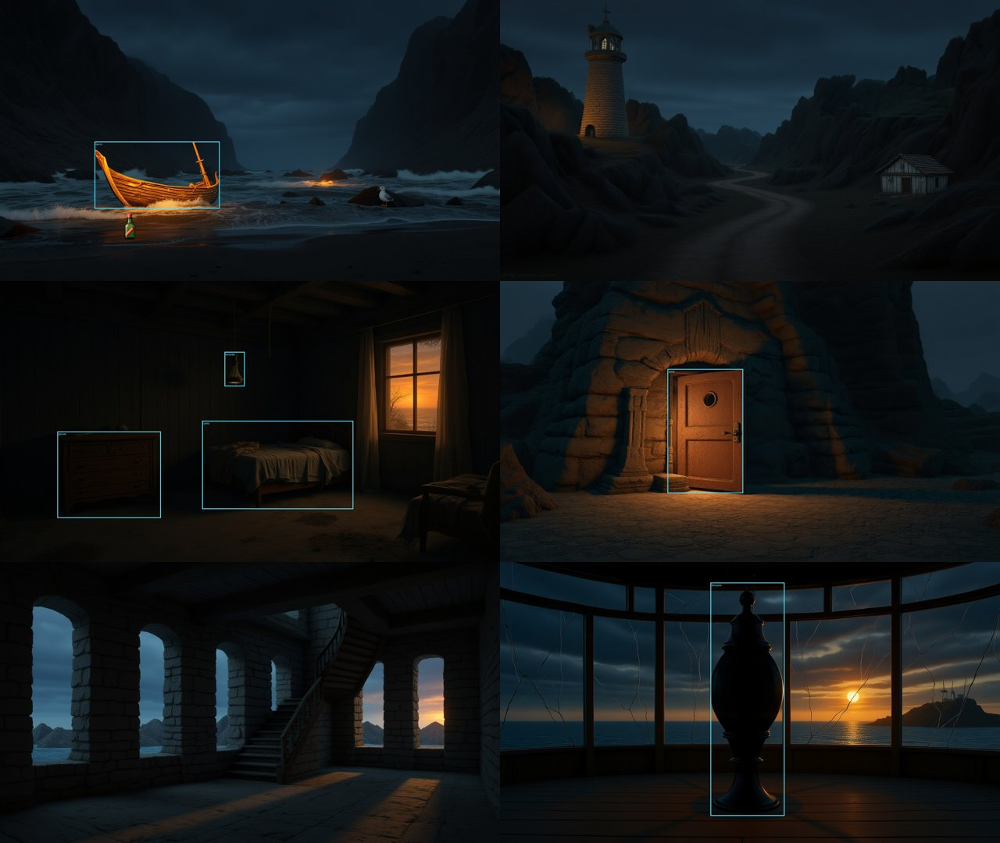
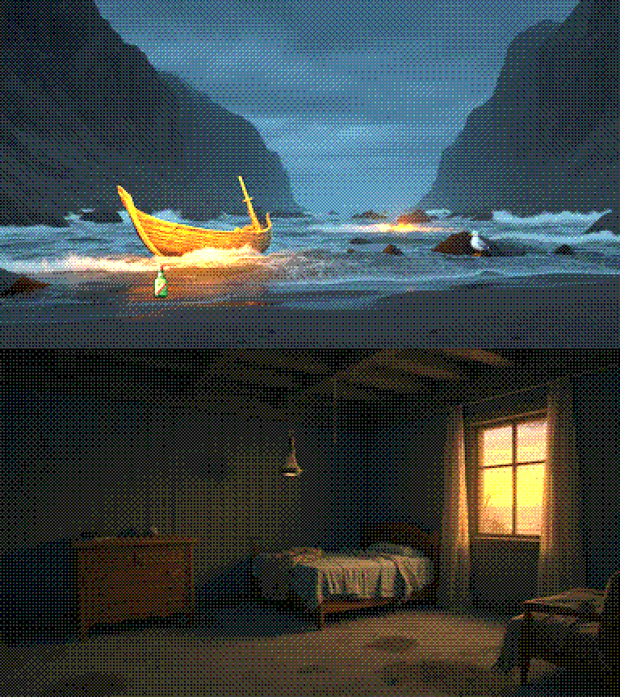

# Saga Engine


Uma engine de adventures em que **a IA opera o editor**. Você descreve o jogo ("um mistério numa
mansão, 4 salas, a chave está escondida no relógio"), e o Diretor (Gemini com ferramentas) cria as
cenas, os objetos e a lógica. Depois ele **joga o próprio jogo** para conferir se o puzzle tem
solução e chega ao fim. Você continua no editor, pedindo mudanças ou editando à mão.

O caminho tem duas fases:

1. **Adventures de texto ilustrados**, no espírito dos jogos de 8 bits como *Calixto Island*: o
   jogador digita comandos, lê as respostas e vê uma ilustração de cada local que acompanha a
   história. Esta fase já funciona.
2. **Point & click**, no estilo de *Monkey Island*: personagem andando na tela, verbos, inventário
   com ícones e diálogos com escolhas. Ainda não começou.

> 🚧 **Em desenvolvimento.** A parte de texto funciona de ponta a ponta; o point & click e
> várias telas do editor ainda são experimentais. Veja [`TODO.md`](TODO.md).

## O que existe hoje

- **SES, a linguagem de script**: é pequena e tem parser de verdade, com erros que dizem linha e
  coluna. Cobre handlers (`on examine`, `on use with chave`...), flags, `if`/`else`, saídas que
  abrem durante o jogo e final. Ela tem testes. Veja [Como funciona a SES](#como-funciona-a-ses).
- **Motor de adventure em texto** (`backend/ses/engine.py`):
  - entende comandos em português (`pegar a chave velha`, `usar chave na porta`, `n`, `inventário`);
  - guarda o estado completo do jogo (inventário, flags, objetos movidos, saídas abertas);
  - não guarda sessão no servidor: o cliente devolve o estado a cada comando.
- **O Diretor** (`backend/services/gemini_orchestrator.py` e `backend/ses/director_tools.py`):
  - ferramentas para criar e ligar cenas, criar objetos e salvar scripts, todos validados;
  - uma ferramenta `playtest`, para a IA jogar o jogo que construiu;
  - conversa com memória por projeto e espera a cota da Gemini quando ela estoura.
- **Editor web** (React + Vite):
  - canvas de cenas, propriedades do objeto (descrição, "pode ser pego", escondido, outros nomes);
  - editor de script que valida enquanto você digita;
  - chat com o Diretor e o player de texto.
- **Projeto de exemplo** [`projects/O Farol`](projects/O%20Farol/project.json): um adventure curto
  (6 cenas) escrito em SES. A solução está em [`tools/build_demo_farol.py`](tools/build_demo_farol.py).
  Os cenários foram gerados pelo Diretor com FLUX.1 Kontext numa RTX 3060.

Um trecho real, de quando o Diretor criou e testou um jogo sozinho:

```
> leste
== Canto da Cabana ==
Um canto escuro e empoeirado da cabana, onde tábuas soltas rangem sob seus pés.
> examinar tabuas
Você mexe nas tábuas e acha uma chave!
> pegar chave
...
> usar chave na porta
A chave abre a porta com um estalo!
> norte
Parabéns! Você escapou da cabana e alcançou a liberdade na floresta!
```

## Como funciona a SES

**SES (Saga Engine Script)** é a linguagem da lógica do jogo. Ela descreve o que acontece quando o
jogador examina, pega, usa, abre ou fala com algo, e quando entra numa cena. É pequena de propósito:
assim uma pessoa ou a IA conseguem escrever scripts certos de primeira, e o que estiver errado é
apontado na hora. A referência completa está em [`docs/SES.md`](docs/SES.md).

### O jogo sem script

Um projeto tem **cenas** (salas, ligadas por saídas como `norte` ou `"porta"`) e **objetos**. Só
com isso, o motor de jogo já faz um adventure em texto completo:

- `olhar` descreve a cena, os objetos visíveis e as saídas;
- `examinar X` mostra a descrição do objeto;
- `pegar X` e `largar X` funcionam com objetos marcados como "pode ser pego";
- `norte`, `n`, `ir para leste`, `subir` e `entrar` andam pelas saídas;
- `inventário` e `ajuda` mostram o que você carrega e os comandos.

Os objetos são achados pelo nome, pelos outros nomes ou pelo id, sem ligar para acentos nem
maiúsculas. `pegar a chave velha` acha "Chave Enferrujada" se ela tiver o outro nome "chave velha".

O script só entra quando um objeto ou uma cena precisa fazer **algo diferente** do padrão.

### Handlers

Um script é uma lista de handlers, um por evento. O handler **substitui** o comportamento padrão
daquele evento:

```
on examine { ... }            // examinar
on take { ... }               // pegar: só vai para o inventário se o script chamar `take`
on use with chave { ... }     // usar a chave neste objeto (ou este objeto na chave)
on enter { ... }              // cena: toda vez que o jogador entra
on first_enter { ... }        // cena: só na primeira vez
```

Os eventos de objeto são `examine`, `take`, `drop`, `use`, `open`, `close`, `push`, `pull` e
`talk`.

### Comandos e condições

- **Texto e fim:** `say "texto"` e `end "texto"` (termina o jogo).
- **Objetos:**
  - `take` e `drop` põem o objeto no inventário ou o largam na cena;
  - `remove` tira o objeto do jogo;
  - `show` e `hide` mostram ou escondem um objeto;
  - `move obj to cena` leva o objeto para outra cena.
- **Mapa:** `goto cena` leva o jogador; `link norte to cena` e `unlink norte` abrem e fecham saídas
  durante o jogo.
- **Memória do jogo (flags):** `set flag`, `set flag = 3`, `clear flag`, `inc flag` e `dec flag`.
- **Decisões:** `if ... { } else if ... { } else { }`, com as condições:
  - `has(obj)`, `here(obj)`, `flag(f)`, `flag(f) >= 3`, `in(cena)` e `visited(cena)`;
  - combinadas com `and`, `or`, `not` e parênteses.

### Exemplo: a porta do farol

```
on examine {
  if flag(porta_aberta) { say "A porta está aberta. Lá dentro, uma escada sobe." }
  else { say "Uma porta de ferro, trancada, com uma fechadura grande." }
}
on use with chave {
  if flag(porta_aberta) { say "Já está aberta." }
  else { set porta_aberta; link norte to "Dentro do Farol"; say "A chave gira com um rangido." }
}
```

`usar chave na porta` procura `on use with chave` na porta e, se não achar, `on use with porta` na
chave. Tanto faz em qual dos dois objetos a regra foi escrita.

### Erros e validação

A SES tem um parser de verdade: tokenizer e descida recursiva, em
[`backend/ses/language.py`](backend/ses/language.py). Os erros dizem a linha, a coluna e o que se
esperava:

```
linha 2, coluna 3: comando desconhecido 'narrate'; comandos: say, take, drop, ...
linha 1, coluna 25: esperava ';' ou nova linha antes de 'de' — nomes com espaço vão entre aspas, ex.: "chave de ferro"
```

O script também é conferido contra o projeto: o validador **avisa** quando cita um objeto ou uma cena
que não existe.

- **No editor**, o script é validado enquanto você digita.
- **Com o Diretor**, as ferramentas da IA recusam salvar um script com erro e devolvem a mensagem,
  para que a IA corrija sozinha.
- **No jogo**, um script quebrado não derruba nada: o objeto continua com o comportamento padrão.

### Como o Diretor usa a SES

1. Você descreve o jogo no chat.
2. O Diretor cria as cenas e as saídas, cria os objetos e escreve os scripts em SES, tudo por
   ferramentas validadas ([`backend/ses/director_tools.py`](backend/ses/director_tools.py)).
3. Ele roda `playtest` com a sequência de comandos que deveria vencer o jogo. O mesmo motor que você
   usa para jogar executa essa sequência.
4. Se o jogo não chega ao fim, ele lê onde travou, corrige e testa de novo.

### O estado do jogo

O motor ([`backend/ses/engine.py`](backend/ses/engine.py)) não guarda sessão no servidor. Cada
comando recebe o estado e devolve o próximo. O estado é um JSON com:

- a cena atual e onde cada objeto está;
- as flags e as saídas abertas ou fechadas;
- as cenas visitadas e se o jogo terminou.

Salvar o jogo é gravar esse JSON. Jogar nunca altera o projeto.

## Instalação

```bash
git clone https://github.com/csilvino/saga.git
cd saga
python -m venv .venv
# Windows: .\.venv\Scripts\activate      macOS/Linux: source .venv/bin/activate
pip install -r requirements.txt
```

1. **Sua chave da Gemini.** A IA usa a chave de cada pessoa; não há login.
   - Crie a sua no [Google AI Studio](https://aistudio.google.com/apikey).
   - Cadastre no editor em **Configurações → API Keys** (botão "Configurar IA" no topo); "Salvar e
     testar" confere se ela funciona.
   - Ali mesmo você escolhe o modelo de texto e o de imagem.
   - A chave fica só no seu computador, em `~/.saga_engine_settings.json`, fora do projeto.
2. **Backend**, na porta 8070:
   ```bash
   python -m backend.main
   ```
3. **Frontend**, na porta 5173:
   ```bash
   cd frontend
   npm install
   npm run dev
   ```
4. Abra o projeto **O Farol** e clique em jogar. Ou crie um projeto vazio e peça ao Diretor:
   *"crie um adventure curto de fuga de uma cabana, com um objeto escondido e um final; teste a solução"*.

No plano gratuito da Gemini, o limite é de cerca de 15 chamadas por minuto, e cada passo do Diretor
gasta uma. Num jogo pequeno ele leva de 1 a 2 minutos, porque espera o limite sozinho.

## Imagens: cenários no mesmo estilo



Para que todas as cenas pareçam do mesmo jogo, o Saga gera **uma primeira imagem** e a usa como
**referência de estilo** para as outras. Você pede ao Diretor no chat ("crie os cenários de todas as
cenas no estilo da primeira"), e ele gera e aplica uma cena por vez.

Há três caminhos para a primeira imagem:

1. **Gemini na web, de graça:** gere a imagem no site da Gemini (Nano Banana) e ponha como fundo da
   primeira cena.
2. **Gerador local, de graça:** [FLUX.1 Kontext](local_image_worker/README.md) na sua GPU NVIDIA de
   12 GB. Leva uns 4 minutos por imagem.
3. **Chave paga da Gemini:** o Nano Banana não tem cota no plano gratuito da API. Com faturamento
   ativado, tudo é gerado pela nuvem.

**O que o texto cita, o jogador vê.** O Diretor faz a arte com a ferramenta `create_scene_art`, uma
cena por vez:

- os objetos fixos (barco, porta, cama) são pintados no cenário e ganham uma área clicável por cima;
- os que podem sumir ou aparecer (itens que o jogador pega, objetos escondidos, personagens) viram
  sprites com fundo transparente, no estilo da cena;
- a Gemini olha o cenário gerado para posicionar tudo.

"Pegar garrafa" tira a garrafa da tela e a põe no inventário. Uma cena também pode ter **variantes**
ligadas ao estado do jogo. Por exemplo, a mesma imagem da Base do Farol, com a porta aberta, aparece
quando `flag(porta_aberta)` é verdadeira.

Durante o jogo, o estado é salvo sozinho no navegador. Um reload continua de onde você parou, e
RECOMEÇAR inicia um jogo novo.

A escolha entre nuvem e local fica em **Configurações → API Keys → Fonte das imagens**. Como fizemos,
com exemplos e o que deu errado no caminho: [`docs/IMAGENS.md`](docs/IMAGENS.md).

## Estilo clássico (fase 1)



O player tem dois botões no topo:

- **CLÁSSICO / PAINÉIS**:
  - CLÁSSICO põe a ilustração em cima e o texto embaixo, com fonte de terminal (VT323) e uma linha
    de comando, como nos adventures de 8 bits;
  - PAINÉIS é o layout com inventário e texto nas laterais.
- **RETRÔ**: a ilustração vira pixel art em 384×216, com 125 cores e pontilhado (Bayer). Antes disso
  o brilho é corrigido, para as cenas escuras não perderem detalhe. Cenário e sprites passam pelo
  mesmo filtro, e por isso os itens se integram melhor à cena.

O texto também pode seguir o formato clássico:

```
📍 Praia. Areia fria e destroços por toda parte. A tempestade passou, mas o seu barco não.
Vejo: garrafa, barco, gaivota.
Saídas: norte.
> PEG GARRAFA
Você pegou garrafa.
```

O parser aceita abreviações de 3 letras, como nos jogos da época: `PEG CHAVE`, `EXA PORTA`, `ABR
GAVETA`. Também aceita `N`, `S`, `L`, `O`, `I`, imperativos (`pega`, `abre`) e maiúsculas.

O autor escolhe o padrão do jogo em `project.json`:

```json
"presentation": {"style": "classico", "layout": "classico", "retro": false}
```

O Diretor faz isso com a ferramenta `set_presentation`. O jogador pode trocar o layout e o modo retrô
no próprio player; a escolha fica salva no navegador.

## Testes

```bash
pip install pytest
python -m pytest tests/test_ses.py tests/test_director_tools.py tests/test_demo_farol.py
```

## Estrutura

```
backend/
  ses/                language.py (parser, validação, referência), engine.py (motor de jogo),
                      world.py, director_tools.py (ferramentas da IA)
  services/           orquestrador Gemini, geração de imagens
  api/routes/         FastAPI: /api/game, /api/ses, /api/orchestrator, cenas, objetos...
frontend/             editor React + Vite
projects/             projetos (O Farol = exemplo em SES; Calixto Island = experimento visual)
local_image_worker/   gerador local de imagens (FLUX.1 Kontext), processo e venv próprios
docs/                 SES.md (a linguagem), IMAGENS.md (cenários no mesmo estilo),
                      project_format.md; docs/legacy = visão antiga
runtime/, editor/     protótipos antigos (Arcade / PySide6), fora do fluxo atual
```

## Licença

MIT. Veja [LICENSE](LICENSE).
