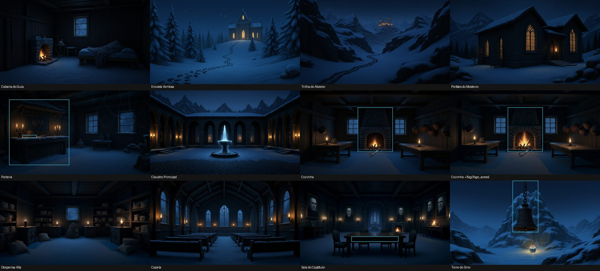
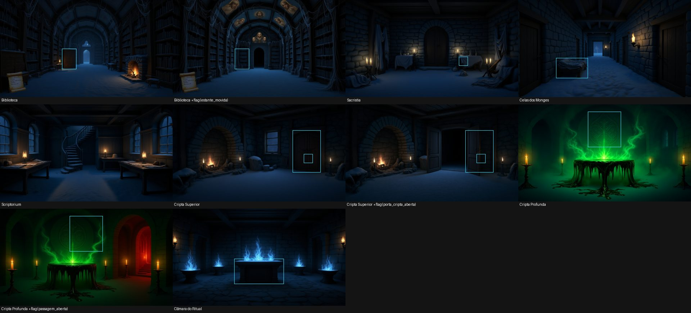

# A ficha do jogo

A ficha é **o jogo inteiro num arquivo só**: mapa, objetos, scripts SES, direção de arte, as
variantes do cenário e a solução. Ela fica em `projects/<jogo>/ficha.yaml`. Com ela, montar um
adventure deixa de ser uma conversa de dezenas de passos e vira um processo fixo:

1. **Escrever a ficha.** O Diretor escreve, você escreve, ou os dois.
2. **Verificar.** O Saga aponta os furos de lógica, roda a solução e cada morte, e um jogador
   automático tenta vencer sozinho.
3. **Montar.** Sem erros, o projeto inteiro é criado de uma vez.
4. **Gerar a arte.** Roda sozinha, em segundo plano, com retomada se parar.

A ficha é o "parâmetro" do jogo: dá para guardar no git, editar à mão e montar de novo. Para um
jogo novo, troque o tema e mantenha a estrutura.

## Por que existe

Pedido ao Diretor um jogo grande ("como os adventures de terror de 8 bits, 18 locais"), a Gemini
cria ótima atmosfera e erra a lógica:

- sala sem caminho;
- solução que não bate com o mapa;
- item que não serve para nada;
- morte garantida.

Num teste, pedido "4 puzzles e 2 mortes", ela entregou um jogo que se vence em 8 comandos e disse que
estava pronto. Ela não percebe esses erros sozinha, mas corrige bem quando alguém aponta o problema
exato. A ficha dá a ela esse alguém: um verificador que aponta o problema com nome e lugar.

## Formato

```yaml
nome: Neve sobre o Claustro             # igual ao nome do projeto
descricao: Uma frase para a tela inicial.
inicio: Cabana do Guia                  # onde o jogador começa
apresentacao: {estilo: classico, layout: classico, retro: false}
arte:
  estilo: mosteiro gótico na neve, noite de nevasca, tons frios com luz quente de velas
  referencia: Cabana do Guia            # gerada primeiro; as outras copiam o estilo dela
requisitos: {cenas: 18, puzzles: 10, mortes: 3}   # o que foi pedido; a verificação cobra

cenas:
  - nome: Portaria
    descricao: 2 ou 3 frases de ambientação, sem listar saídas nem objetos.
    script: |                           # opcional: SES da cena (on enter / on first_enter)
      on first_enter { say "O vento bate a porta atrás de você." }
    saidas:
      norte: Claustro Principal         # a volta (sul) é criada sozinha
      leste: {para: Abismo, volta: false}   # só ida
    variantes:                          # outra versão do cenário enquanto a condição valer
      - quando: flag(fogo_aceso)
        mudanca: a lareira acesa com fogo forte, brilho laranja nas paredes
    objetos:
      - nome: balcão
        descricao: Aparência (vira imagem) e o que o jogador lê ao examinar.
        tipo: movel                     # item, movel, porta, personagem...
        pegavel: false
        escondido: false                # true: só aparece com show (ou take) num script
        apelidos: [balcao]
        script: |
          on open { show fosforos; say "Dentro, uma caixa de fósforos." }

testes:
  vitoria: corta os laços               # trecho do texto do end de vitória
  solucao: [pegar lanterna, sul, leste, abrir balcao, pegar fosforos, ...]
  mortes:
    - nome: cripta sem luz
      comandos: [sul, leste, leste, leste, norte, leste, leste, baixo]
      fim: despenca                     # trecho do texto do end dessa morte
```

Regras:

- Nomes de cenas e de objetos são únicos no jogo inteiro.
- Uma passagem que abre durante o jogo não vai em `saidas`. O script que a abre faz
  `link norte to "Câmara do Ritual"`.
- A lógica é SES normal ([docs/SES.md](SES.md)).

## O que a verificação aponta

| | O que é | Exemplo de mensagem |
|---|---|---|
| erro | script com erro de sintaxe | `create_object: ... linha 1, coluna 19: bloco sem '}' de fechamento` |
| erro | referência a objeto ou cena que não existe | `script de remo: cena 'Lugar Nenhum' não existe` |
| erro | cena sem caminho a partir do início (contando os `link` dos scripts) | `a cena 'Porão' não tem caminho a partir do início` |
| erro | flag testada que nenhum script marca | `a flag 'energia' é testada (botão) mas nenhum script a marca com set` |
| erro | objeto escondido que nunca aparece | `'moeda' começa escondido e nenhum script o mostra (show) ou entrega (take/move)` |
| erro | a solução não chega à vitória, ou uma morte não acontece | `solução: o jogo não terminou; último comando 'cima' → ...` |
| erro | comando da solução que o jogo recusa | `solução: o jogo recusou 1 comando(s): pegar oleo` |
| erro | requisitos não cumpridos | `requisitos.puzzles = 4, mas a solução só tem 2 ações de puzzle (...)` |
| erro | **atalho**: o jogador automático venceu sem passar por algo que a solução exige | `ATALHO: o jogador automático venceu sem passar por: flag porta_aberta, ...` |
| aviso | item pegável que nenhum script usa | `o item 'picareta' pode ser pego mas nenhum script o usa` |
| aviso | objeto sem descrição (a arte depende dela) | |
| aviso | cena que o jogador automático não alcançou | |

**Ações de puzzle** são os comandos da solução que mudam o jogo sem ser andar ou pegar: abrir, usar
X em Y, empurrar, ler algo que revela uma pista. É assim que `requisitos.puzzles` mede se um jogo
tem os puzzles que foram pedidos.

### O jogador automático

O jogador automático joga sem a solução ([`backend/ses/blueprint.py`](../backend/ses/blueprint.py),
`explore`):

- andar e pegar itens soltos não contam como passo: ele percorre tudo o que alcança e junta o que
  acha;
- em cada lugar, tenta as ações que os scripts entendem: abrir, empurrar, usar X em Y...;
- guarda só as ações que mudam alguma coisa, segue adiante e volta atrás quando trava.

No *Neve sobre o Claustro*, com 18 cenas e 13 ações de puzzle, ele vence em cerca de 3 segundos.

Para que serve:

- **Prova independente.** Uma vitória dele é uma prova que não depende da solução de quem escreveu.
  O caminho que ele achou é jogado de novo no motor (`confirmado`).
- **Atalhos.** Se ele vence sem passar por algo que a solução exige (uma flag, um objeto revelado,
  uma passagem aberta), há um atalho. Foi assim que apareceu a escada da mina, que dava para subir
  com `cima` sem consertá-la.
- **Finais.** Ele lista as mortes e as vitórias que encontrou pelo caminho.

**Limite:** ele não prova a ausência de beco sem saída. Um jogo em que o jogador pode gastar um item
no lugar errado e ficar preso ainda passa. Mortes e becos sem saída de propósito são do gênero, mas
convém revisar.

## Montar de novo sem perder a arte

A montagem é sempre feita do zero a partir da ficha, mas reaproveita o projeto anterior:

- cenas e objetos que mantêm o nome mantêm o **id** (os jogos salvos continuam valendo);
- também mantêm o **cenário**, o **sprite**, a **posição**, o tamanho e a marca de "pintado";
- variantes com a mesma condição mantêm a imagem.

Por isso dá para corrigir um texto, um script ou um puzzle depois da arte pronta. Só o que é novo
fica para a próxima rodada de arte.

## Som

A ficha também diz o que se ouve. Os sons são opcionais e há três tipos:

```yaml
cenas:
  - nome: Cozinha
    som:                                   # som ambiente, em loop enquanto o jogador está na cena
      ambiente: vento uivando lá fora, madeira rangendo
      quando:                              # outro ambiente enquanto a condição valer
        - {quando: flag(lareira_acesa), ambiente: fogo crepitando, vento ao longe}
    objetos:
      - nome: relógio
        som: tique-taque de relógio de pêndulo         # som do objeto, em loop enquanto ele está à vista
      - nome: corvo
        som: {descricao: um corvo grasna, repete: as vezes, intervalo: [20, 60], quando: not flag(x)}
      - nome: sino
        script: |
          on push { play "badalada grave de sino de bronze"; say "..." }   # som de evento
```

- **Ambiente da cena:** toca em loop e faz uma transição suave quando o jogador muda de cena ou
  quando entra em vigor outro ambiente do `quando`, como as variantes de imagem.
- **Som de objeto:** toca em loop (`repete: sempre`, o padrão) ou de vez em quando (`repete: as
  vezes`, em intervalos sorteados entre os dois números de `intervalo`, em segundos). Só toca
  enquanto o objeto está à vista e, se houver `quando`, enquanto a condição valer.
- **Som de evento:** `play "..."` em qualquer script. O mesmo texto em vários scripts vira um som só.

Descreva o som pela fonte, pelo material e pelo lugar, sem música nem vozes. A verificação confere
os campos e as condições.

**Gerar:** o botão **Gerar sons** no painel Ficha, `python tools/build_game.py "Meu Jogo" --som` ou a
ferramenta `start_game_sound` do Diretor. A Gemini transforma cada descrição num prompt em inglês, e
o [gerador local](../local_image_worker/README.md) faz os sons na GPU com o **Stable Audio Open**:

- ambientes de 30 s e sons de objeto de 10 s, como loops sem emenda (o fim se funde com o começo);
- eventos de 1 a 8 s, sem silêncio nas pontas.

Cada som é gravado em `audio/` assim que fica pronto, e dá para retomar a geração. Ao remontar a
ficha, o som cujo texto não mudou mantém o arquivo.

**No jogo:** o player mistura tudo no navegador. O botão de som liga e desliga, e no modo RETRÔ o
som passa por um filtro de 8 bits.

## Revisão da arte

Cada imagem gerada passa por uma revisão antes de entrar no jogo. A Gemini olha a imagem como um
jogador olharia:

- **cenário:** mostra os objetos fixos? Concorda com o texto? Mostra a cena **como ela começa**? Uma
  lareira que o jogador ainda vai acender aparece apagada, porque a variante é que mostra o fogo.
- **variante:** a mudança aparece com clareza? Continua sendo a mesma sala, sem nada novo em outro
  lugar (pinturas no teto, uma lareira que sumiu)? A comparação vai numa imagem só, com o antes em
  cima e o depois embaixo.

Quando a imagem não passa, a revisão escreve a correção e o Saga a aplica: edita a mesma imagem, ou
gera de novo quando a edição não salva. Isso acontece até 2 vezes por imagem. O que continua errado
depois disso fica guardado no projeto e aparece no painel **Ficha**, em "A revisão ainda vê...", para
você decidir. Gosto, clima e estilo (neve, poeira, cores) não contam como erro.

O pedido de cada variante também diz **onde** fica o objeto que muda ("o armário à esquerda do
centro"), tirando a posição da área clicável dele.

A revisão usa o modelo `models/gemini-3.5-flash`. Os modelos *lite* erram justamente na comparação
de duas imagens. Para trocar, use a chave `gemini_review_model` em `~/.saga_engine_settings.json`
ou a variável `SAGA_REVIEW_MODEL`.

Para revisar um jogo que já tem arte:

```bash
python tools/review_art.py "Neve sobre o Claustro"                    # só relata (Gemini, sem GPU)
python tools/review_art.py "Neve sobre o Claustro" --cena Biblioteca  # uma cena
python tools/review_art.py "Neve sobre o Claustro" --corrigir         # também corrige (GPU)
```

O Diretor tem a mesma revisão na ferramenta `review_scene_art`.

## Onde usar

**No editor:** o botão **Ficha** no topo abre a ficha do projeto. Num projeto que ainda não tem
ficha, o editor mostra um rascunho tirado do projeto atual. Os botões:

- **Verificar** mostra o relatório;
- **Montar o jogo** monta o projeto e recarrega o editor;
- **Gerar arte** começa a arte em segundo plano e mostra o andamento.

**Pelo Diretor:** num pedido de jogo inteiro, ele usa quatro ferramentas:

1. escreve a ficha;
2. chama `check_blueprint` até o relatório dar `"ok": true`;
3. salva com `save_blueprint`;
4. só quando você pedir a arte, chama `start_game_art`.

Para mudanças grandes, ele lê a ficha com `get_blueprint`, edita e salva de novo.

**Pela linha de comando:**

```bash
python tools/build_game.py "Neve sobre o Claustro"                     # verifica a ficha do projeto
python tools/build_game.py "Meu Jogo" --ficha rascunho.yaml --salvar   # verifica e monta
python tools/build_game.py "Meu Jogo" --arte                           # gera a arte que falta
python tools/build_game.py "O Farol" --exportar > ficha.yaml           # ficha de um projeto feito à mão
```

**Pela API:**

| Rota | O que faz |
|---|---|
| `GET /api/blueprint/{jogo}` | a ficha (ou um rascunho exportado) |
| `POST /api/blueprint/check` | verifica sem salvar |
| `POST /api/blueprint/build` | verifica e monta |
| `POST /api/blueprint/art/{jogo}` | começa a arte em segundo plano |
| `GET /api/blueprint/art/{jogo}` | andamento da arte |

As rotas `check` e `build` recebem `{"project_name", "text"}`.

## Exemplo

[`projects/Neve sobre o Claustro/ficha.yaml`](../projects/Neve%20sobre%20o%20Claustro/ficha.yaml):
terror gótico num mosteiro isolado pela neve. Tem 18 locais, 22 objetos, 13 ações de puzzle e 3
mortes, no mesmo gênero e na mesma escala dos adventures de terror de 8 bits.




*As 18 cenas e as 4 variantes (marcadas com \*). Foram geradas por `python tools/build_game.py
"Neve sobre o Claustro" --arte`, em cerca de 4 horas de GPU, com retomada depois de uma
interrupção. Os contornos azuis são áreas clicáveis de objetos pintados. Um defeito conhecido: o
chão dos interiores puxou a neve da cena de referência.*

