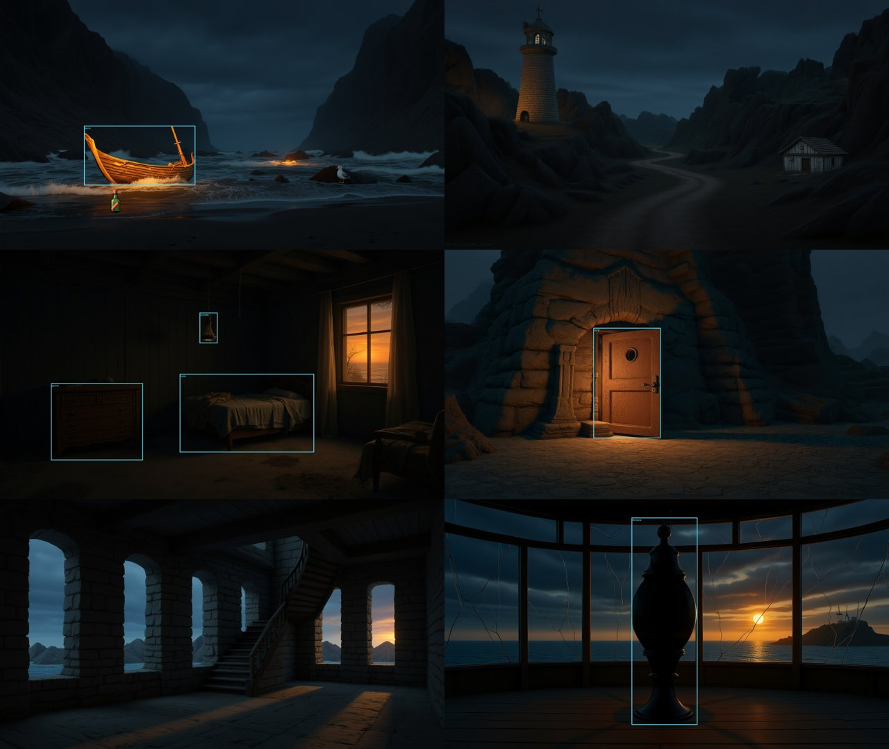
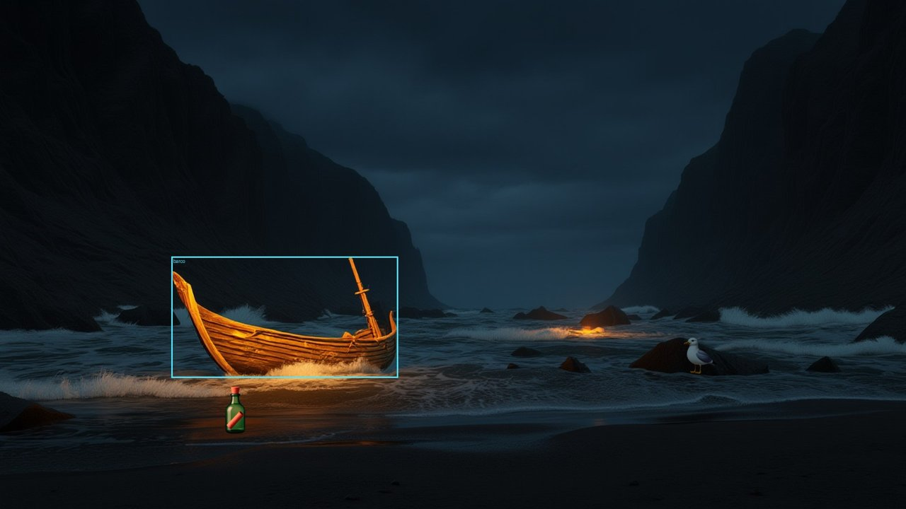
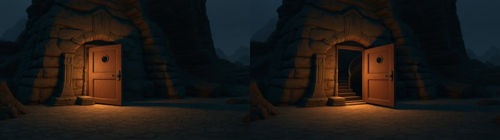
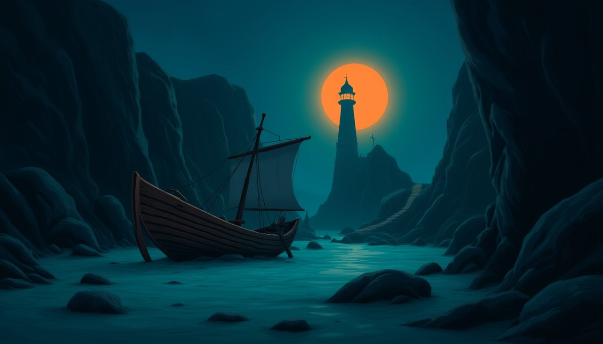
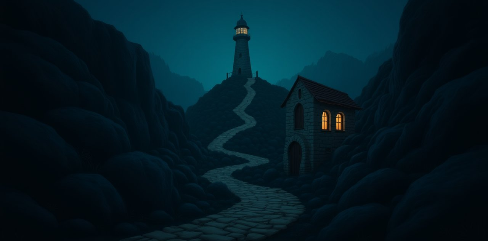
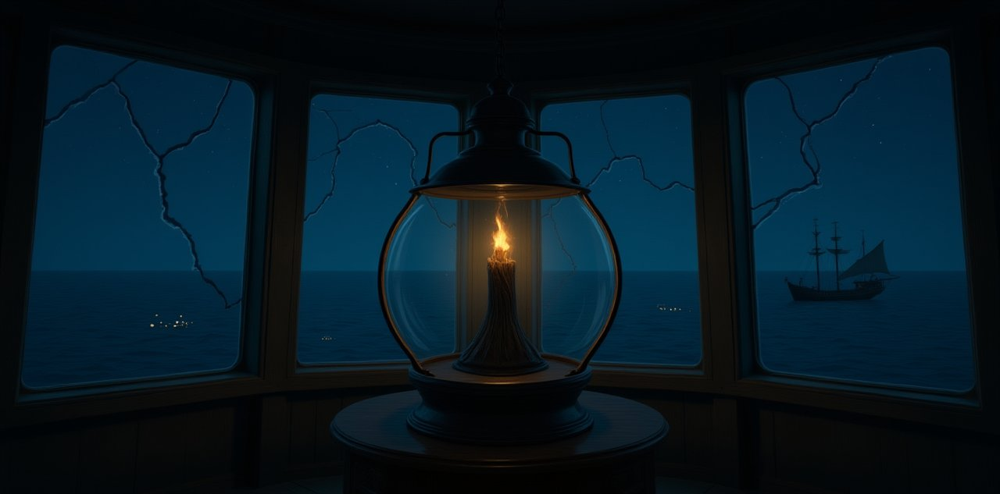
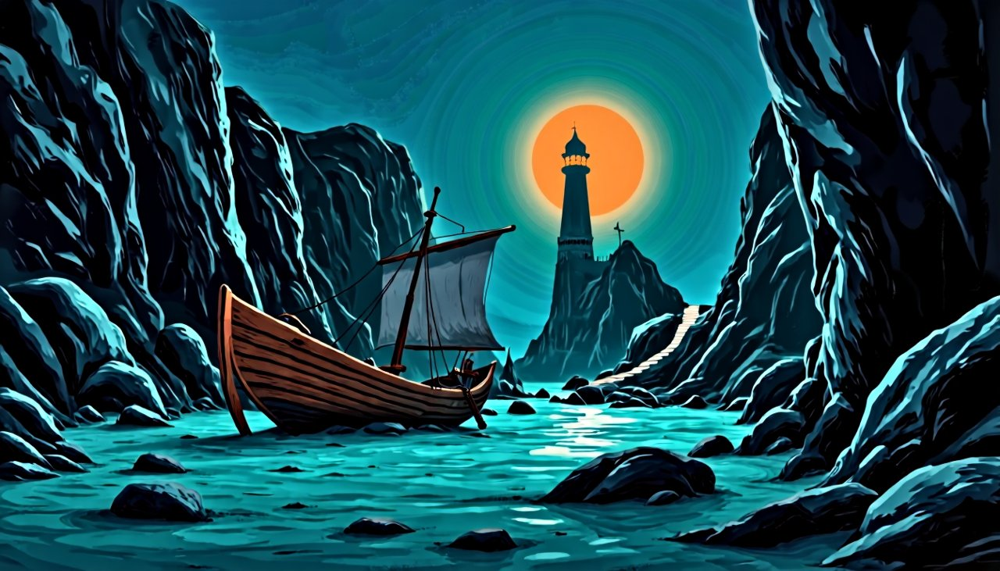

# Imagens: cenários no mesmo estilo

Um adventure point & click precisa que todas as cenas pareçam do **mesmo jogo**: mesmo traço, mesma
paleta, mesma luz. Gerar cada cena separada, só com texto, dá imagens bonitas que não combinam entre
si. A solução do Saga é gerar **uma primeira imagem** e usá-la como **referência de estilo** para
todas as outras.



*As 6 cenas do projeto de exemplo [O Farol](../projects/O%20Farol/project.json). Quem pediu as
imagens foi o Diretor, pela conversa: a Praia foi gerada só com texto, e as outras 5 usaram a Praia
como referência. Os contornos azuis são as áreas clicáveis dos objetos pintados no cenário. A
garrafa e a gaivota, na Praia, são sprites. Tudo rodou numa RTX 3060 12 GB, sem custo.*

## Como fazer

### 1. A primeira imagem

Ela define o estilo do jogo inteiro. Há três caminhos:

- **Gemini na web, de graça.** Gere a imagem conversando no [Gemini](https://gemini.google.com),
  que usa o Nano Banana, e ajuste até gostar. Salve o arquivo e coloque-o como fundo da primeira cena
  no editor.
- **Gerador local (FLUX), de graça.** Peça ao Diretor a primeira cena sem referência. Foi assim
  que nasceu a Praia de O Farol.
- **Chave paga da Gemini.** O Nano Banana (`gemini-2.5-flash-image` e similares) **não tem cota no
  plano gratuito** da API, só no site. Com faturamento ativado no
  [Google AI Studio](https://aistudio.google.com/apikey), o Saga gera todas as imagens pela nuvem, e
  o Nano Banana também aceita imagem de referência.

### 2. As outras cenas

Com a primeira cena pronta, peça ao Diretor no chat, por exemplo:

> Crie os cenários de todas as cenas no mesmo estilo da primeira. Use a primeira cena como referência.

O Diretor chama `create_scene_art` uma cena por vez, passando `reference_scene` = a primeira.

A fonte das imagens se escolhe em **Configurações → API Keys → Fonte das imagens**:

- **Gemini (nuvem):** usa a chave da Gemini e precisa de cota de imagem.
- **Local (sua GPU):** usa o [gerador local](../local_image_worker/README.md).

## O que o texto cita, o jogador vê

Um cenário bonito não basta. Se o texto diz "uma gaivota observa você de cima de uma pedra", a
gaivota precisa estar na tela. E quando o jogador digita "pegar garrafa", a garrafa precisa sumir
da cena e aparecer no inventário. Por isso `create_scene_art`
([`backend/services/scene_art.py`](../backend/services/scene_art.py)) não gera só um fundo. Ela
separa os objetos da cena em dois tipos:

| Tipo | Quais objetos | Como aparecem |
|---|---|---|
| **Pintados** | fixos: barco, porta, cômoda, cama | desenhados no próprio cenário; por cima fica uma área clicável invisível |
| **Sprites** | os que podem sumir ou aparecer: pegáveis, escondidos, personagens | imagem própria com fundo transparente, colocada sobre o cenário |



Para uma cena, a ferramenta faz isto:

1. **Prompts.** A Gemini escreve, em inglês, o prompt do cenário, com todos os objetos pintados
   obrigatoriamente visíveis, e uma descrição curta de cada sprite.
2. **Cenário.** O cenário é gerado com a referência de estilo.
3. **Posições.** A Gemini **olha a imagem gerada** e responde:
   - onde está cada objeto pintado, que é onde a área clicável vai ficar;
   - onde cada sprite deve ficar: no chão ou sobre uma superfície, com tamanho coerente com a
     perspectiva.

   Se um objeto pintado não aparece no cenário, a ferramenta avisa, e o Diretor gera a cena de novo.
4. **Sprites.** Os sprites da cena são gerados **juntos**, lado a lado sobre fundo cinza liso, numa
   única imagem que usa o cenário como referência. Uma geração só faz até 4 itens.
5. **Recorte.** O gerador local (`/sprites`) faz o acabamento:
   - remove o fundo com o [rembg](https://github.com/danielgatis/rembg) e separa cada objeto;
   - aproxima a cor e o contraste de cada um ao do cenário em volta;
   - encaixa cada sprite no lugar escolhido, apoiado no chão.

No jogo, o player só desenha os objetos que o motor diz estarem visíveis. "Pegar garrafa" tira a
garrafa da tela e põe a mesma imagem no inventário. Um objeto marcado como "começa escondido" (a chave
sob o lampião) só aparece quando um script faz `show`.

Uma cena completa leva uns 13 minutos numa RTX 3060: o cenário, a folha de sprites e a troca de
modelos.

## Estados: a mesma cena, com a porta aberta

Quando o jogador abre a porta, a imagem precisa mudar, mas só a porta. Uma cena pode ter
**variantes de cenário**, cada uma ligada a uma condição SES:

```json
"variants": [{"when": "flag(porta_aberta)", "background": "backgrounds/Variant_0e507d33.png"}]
```

O motor escolhe a imagem conforme o estado do jogo, e o player troca o fundo na hora. Quem cria a
variante é o Diretor, com `create_background_variant(cena, condição, mudança)`.



O que faz isso funcionar é o comportamento do Kontext que antes atrapalhava. Com saída do **mesmo
tamanho** da imagem de referência, ele **edita** a imagem em vez de criar outra. Por isso a variante
tem o mesmo enquadramento, e as áreas clicáveis continuam valendo nas duas versões.

A mesma edição corrige cenários que contradizem a história, com `edit_scene_background`. O gerador
ignora "apagado" ou "trancado" num prompt, mas segue bem uma edição como "apague a chama" ou "feche a
porta". Em O Farol foi assim que a lâmpada do topo ficou apagada e o fogo sumiu das rochas da trilha.

**Dica:** para um par de estados, gere primeiro o estado mais "cheio" (porta aberta) e derive dele o
outro (porta fechada). As duas imagens ficam com o mesmo brilho, e a troca não dá um "pulo".

**Limite atual:** os sprites saem mais limpos e claros que a pintura do cenário, como figurinhas. O
ajuste de cor ajuda, mas não resolve. Uma ideia para melhorar é gerar os itens já sobre um pedaço do
próprio cenário, com a mesma luz, e recortar depois.

## O gerador local: FLUX.1 Kontext na sua GPU

O [FLUX.1 Kontext \[dev\]](https://huggingface.co/black-forest-labs/FLUX.1-Kontext-dev) é um modelo
aberto que gera uma imagem nova **a partir de uma imagem de referência**. Ele roda num processo
separado, [`local_image_worker/worker.py`](../local_image_worker/worker.py), e o backend do Saga
fala com ele por HTTP. Assim o Saga não precisa instalar torch.

### Exemplos

| Referência (só texto) | Trilha, com a referência | Topo do farol, com a referência |
|---|---|---|
|  |  |  |

### O que aprendemos

- **Cabe numa GPU de 12 GB, mas não tudo de uma vez.** O codificador de texto T5 ocupa ~9,5 GB e o
  transformer, mesmo comprimido em GGUF Q4, ocupa ~7 GB. O gerador faz duas etapas:
  1. carrega o T5 direto na GPU, codifica o prompt e libera o T5;
  2. carrega o transformer e gera a imagem.

  O pico ficou em 8,9 GB de VRAM, numa máquina com 16 GB de RAM.
- **Tempo:** cerca de 4 minutos por imagem numa RTX 3060. Com a troca de modelos, cada cena levou
  uns 6 minutos.
- **O tamanho de saída precisa ser diferente do tamanho da referência.** Com o mesmo tamanho, o
  Kontext entende que é para **editar** a referência e devolve quase a mesma imagem:

  

  Por isso o gerador cria a cena em 1456×720 e depois recorta e redimensiona para o tamanho pedido.
  Isso também resolveu um farol duplicado que aparecia nas primeiras tentativas.
- **Negação não funciona bem.** Um prompt com "pavio apagado" ainda desenha uma chama. No exemplo
  acima, a trilha mostra o farol aceso, embora no jogo ele esteja apagado. Descreva o que **deve**
  aparecer, não o que deve faltar.
- **Prompts em inglês** funcionam melhor; o Diretor já os escreve assim.
- **Ainda falta:** os sprites saem sem transparência. Os fundos funcionam bem; para objetos, ainda
  é preciso recortar o fundo.

### Licença

Os pesos do FLUX.1 Kontext [dev] usam a licença **FLUX.1 [dev] Non-Commercial**. As imagens geradas
podem ser usadas, mas leia os termos antes de um uso comercial. A instalação está em
[`local_image_worker/README.md`](../local_image_worker/README.md).
